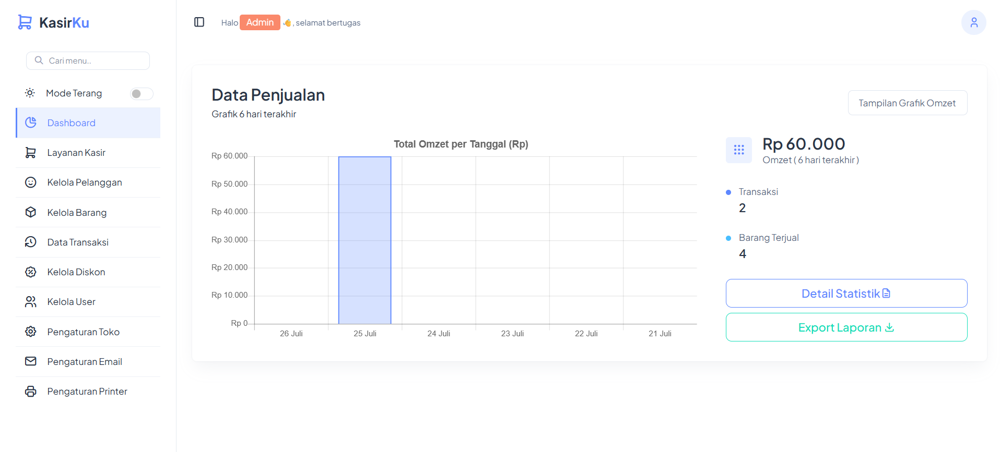
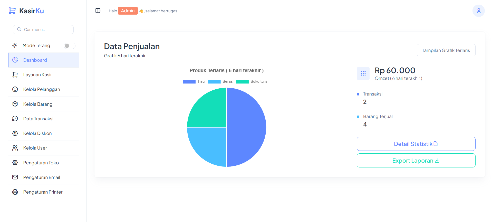
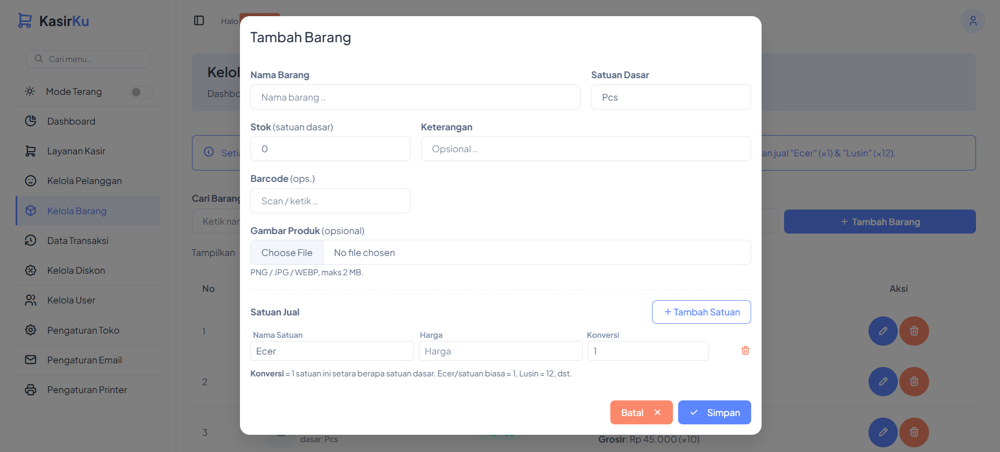
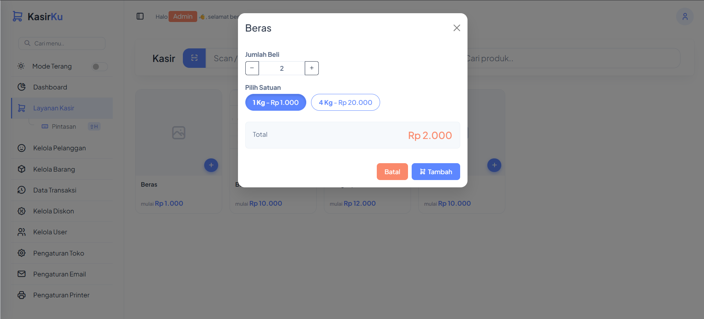
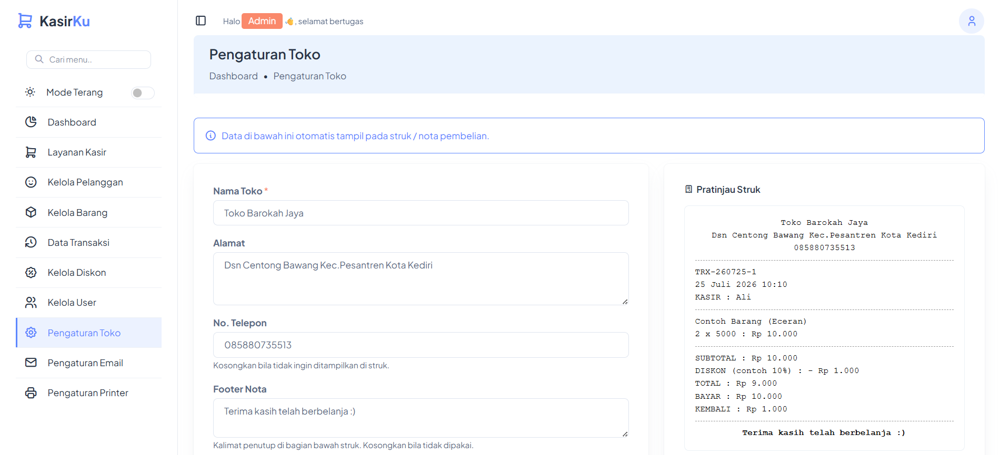
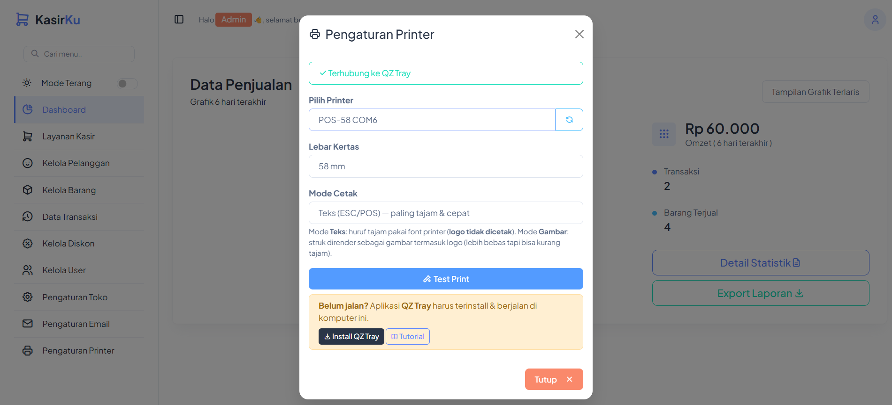
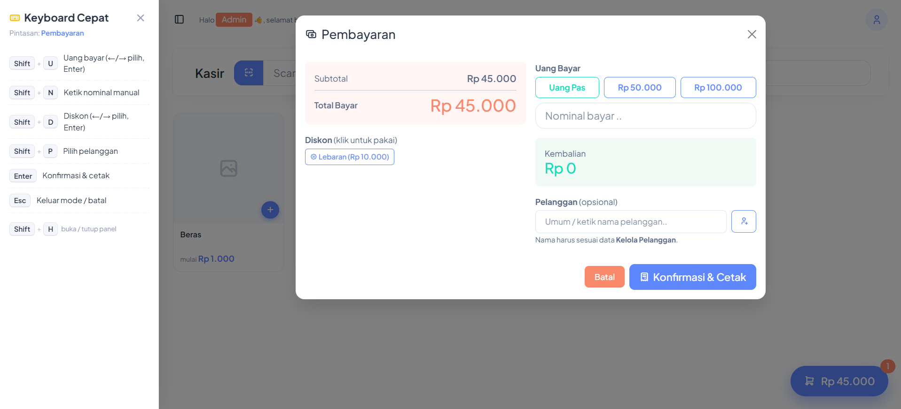

## Aplikasi Kasir POS - Laravel

<p align="center"><a href="https://laravel.com" target="_blank"></a></p>

### Deskripsi
Aplikasi **Kasir POS** untuk manajemen penjualan & persediaan stok, dirancang untuk memperlancar operasi bisnis ritel (cocok untuk toko sembako / kelontong). Aplikasi ini mendukung **multi-user dengan hak akses berbeda**, pengelolaan barang multi-satuan, pelanggan, diskon, laporan penjualan lengkap (export Excel), serta cetak struk ke **thermal printer** (58mm / 80mm) via QZ Tray.

### Preview Aplikasi

**Grafik Omzet**



**Grafik Terlaris**



**Tambah Barang (Multi Satuan)**



**Tambah List Belanjaan (Kasir)**



**Pengaturan Toko**



**Pengaturan Printer**



**Keyboard Cepat (Pintasan Keyboard)**



---

### Fitur

**Autentikasi & Multi-Role**
- **3 role**: `Admin`, `Staf Stok`, `Kasir` — tiap role punya menu & hak akses berbeda.
- Registrasi **hanya untuk akun pertama** (otomatis jadi **Admin**). Setelah itu registrasi ditutup; akun baru dibuat lewat menu **Kelola User**.
- **Reset password** berfungsi penuh: lewat **email** (SMTP) atau di-reset oleh **Admin** dari Kelola User.

**Kasir (Point of Sale)**
- Grid produk cepat (tarik sekali, cari & scroll instan di sisi klien).
- **Scan barcode** (auto tanpa Enter) & pencarian produk.
- **Multi Satuan**: satu barang bisa punya banyak satuan jual (mis. Ecer, Lusin) dengan harga & konversi ke satuan dasar.
- Keranjang, hitung kembalian, tombol **uang pas / pembulatan cepat**.
- **Diskon**: kasir tinggal klik badge diskon (persen atau nominal) — subtotal, diskon, & total tampil jelas.
- **Pelanggan**: **autocomplete** nama (maksimal 5 saran dari server) dengan validasi nama harus terdaftar, atau tambah cepat langsung dari kasir.
- **Modal pembayaran 2 kolom** di layar lebar biar ringkas & tidak memanjang ke bawah.

**Keyboard Cepat (Pintasan Keyboard)**
- Panel bantuan **context-aware** yang isinya menyesuaikan layar aktif (grid, pilih satuan, keranjang, pembayaran) — buka/tutup dengan `Shift + H`, dan menutupi sidebar saat aktif.
- **Layar kasir**: `Shift+S` cari produk, `Shift+Q` scan barcode, `Shift+K` buka keranjang, `Shift+B` langsung bayar, `Shift+Enter` tambah produk saat hasil cari tinggal 1.
- **Pilih satuan**: `←`/`→` ganti satuan, `↑`/`↓` atur jumlah, `Enter` tambah, `Esc` batal.
- **Keranjang**: ketik nama item untuk **fokus** (baris tersorot), `↑`/`↓` ubah jumlah, `Delete` hapus, `Shift+Enter` lanjut bayar, `Esc` reset.
- **Pembayaran**: `Shift+U` pilih uang, `Shift+D` diskon (`←`/`→` lalu `Enter`), `Shift+N` nominal manual, `Shift+P` pelanggan, `Enter` konfirmasi.
- Sengaja hanya memakai `Shift` + huruf / tombol polos di dalam modal — menghindari bentrok shortcut browser & OS (`Ctrl`, `Alt`).

**Master Data**
- **Kelola Barang**: multi-satuan, barcode, foto produk, stok (dengan pengurangan otomatis saat transaksi).
- **Kelola Pelanggan**: data pelanggan relasional (nama unik) untuk rekap pembelian.
- **Kelola Diskon**: diskon tipe **Persen (%)** atau **Nominal (Rp)**, bisa diaktif/nonaktifkan.
- **Kelola User**: kelola akun & role, reset password.

**Laporan & Statistik**
- **Dashboard**: grafik omzet & produk terlaris, ringkasan penjualan (nominal khusus Admin).
- **Data Transaksi**: riwayat transaksi + tab **Statistik Pelanggan** (total belanja, jumlah barang, & daftar transaksi per pelanggan, dimuat per rentang tanggal).
- **Export Laporan Excel** (multi-sheet): Ringkasan, Per Transaksi, Detail Item, Rekap Produk, Rekap Kasir, Rekap Pelanggan, & Rekap Harian.
- **Nomor transaksi** otomatis & aman dari bentrok: format `TRX-YYMMDD-0001` (counter atomik).

**Pengaturan**
- **Pengaturan Toko**: nama, alamat, no. telp, footer nota, logo, & opsi tampilkan nama kasir di struk (dengan pratinjau struk langsung).
- **Pengaturan Email (SMTP)**: konfigurasi server email disimpan di database (bukan `.env`), lengkap dengan tombol **Test Kirim** & panduan provider gratis (Brevo, Resend, SMTP2GO, Gmail).

**Cetak Struk (Thermal Printer)**
- Kompatibel printer termal **58mm / 80mm** via **QZ Tray** (Windows/PC).
- **2 mode cetak**: **Teks (ESC/POS)** — hasil paling tajam pakai font printer; atau **Gambar (HTML)** — layout & logo paling bebas.
- Struk memuat logo (mode HTML), nama toko, nama kasir (opsional), item, **diskon**, total, bayar, kembalian, & footer.
- Tombol cetak diberi **loading** & otomatis **nonaktif bila printer belum terhubung**.

**Lainnya**
- **Dark / Light mode** di seluruh panel & halaman login.
- **Pencarian menu** di sidebar.
- Antarmuka responsif (desktop, tablet, mobile).

---

### Teknologi yang Digunakan
- **Backend**: Laravel 10 (PHP 8.1+)
- **Database**: MySQL / MariaDB
- **Frontend**: Bootstrap 5 (template AdminMart), JavaScript, jQuery, Vite + Tailwind
- **Library**: Yajra DataTables, PhpSpreadsheet (Excel), Chart.js, SweetAlert2, Toastify
- **Hardware**: Thermal Printer via QZ Tray (ESC/POS)

### Kebutuhan Sistem
- PHP **>= 8.1** beserta ekstensi umum Laravel (`pdo_mysql`, `mbstring`, `openssl`, `gd`, `zip`, dll.)
- **Composer**
- **Node.js** (LTS) & **npm**
- **MySQL / MariaDB**
- (Untuk cetak struk) **QZ Tray** terpasang di komputer yang tersambung printer

---

### Instalasi

1. **Clone repository**
   ```bash
   git clone https://github.com/ali819/kasir.git
   cd kasir
   ```

2. **Install dependensi PHP**
   ```bash
   composer install
   ```

3. **Install dependensi & build aset frontend**
   ```bash
   npm install
   npm run build
   ```

4. **Salin & atur file environment**
   ```bash
   cp .env.example .env
   ```
   Buka `.env`, sesuaikan minimal:
   ```env
   APP_NAME="Kasir App"
   APP_URL=http://localhost:8000

   DB_CONNECTION=mysql
   DB_HOST=127.0.0.1
   DB_PORT=3306
   DB_DATABASE=kasir_web
   DB_USERNAME=root
   DB_PASSWORD=
   ```
   > Konfigurasi **email/SMTP** tidak perlu diatur di sini — cukup lewat menu **Pengaturan Email** setelah login sebagai Admin.

5. **Generate application key**
   ```bash
   php artisan key:generate
   ```

6. **Buat database** (sesuai `DB_DATABASE` di atas), lalu **jalankan migrasi**
   ```bash
   php artisan migrate
   ```

7. **Pastikan folder upload dapat ditulis** (untuk logo toko & foto barang) — folder `public/uploads` dibuat otomatis, cukup pastikan permission tulis (Linux):
   ```bash
   chmod -R 775 storage bootstrap/cache public/uploads
   ```

8. **Jalankan aplikasi**
   ```bash
   php artisan serve
   ```
   Akses di browser: `http://localhost:8000`

> **Mode pengembangan (opsional):** jalankan `npm run dev` (Vite) di terminal terpisah sebagai ganti `npm run build` bila sedang mengembangkan aset frontend.

---

### Penggunaan
1. Akses aplikasi melalui browser (`http://localhost:8000`).
2. **Registrasi pertama** → akun ini otomatis menjadi **Admin**. (Registrasi tertutup setelah admin dibuat.)
3. Sebagai Admin, buat akun **Staf Stok** / **Kasir** di menu **Kelola User**.
4. Isi **Pengaturan Toko** (nama, alamat, logo, footer nota).
5. Tambahkan data di **Kelola Barang**, **Kelola Pelanggan**, & **Kelola Diskon** sesuai kebutuhan.
6. Mulai transaksi di **Layanan Kasir**.
7. (Opsional) Atur printer di **Pengaturan Printer** untuk cetak struk otomatis.

### Hak Akses per Role

| Menu | Admin | Staf Stok | Kasir |
| --- | :---: | :---: | :---: |
| Dashboard | ✅ | ✅ | ✅ |
| Layanan Kasir | ✅ | ❌ | ✅ |
| Kelola Pelanggan | ✅ | ❌ | ✅ |
| Kelola Barang | ✅ | ✅ | ❌ |
| Pengaturan Toko | ✅ | ✅ | ❌ |
| Data Transaksi & Statistik | ✅ | ❌ | ❌ |
| Kelola Diskon | ✅ | ❌ | ❌ |
| Kelola User | ✅ | ❌ | ❌ |
| Pengaturan Email | ✅ | ❌ | ❌ |
| Export Laporan (nominal) | ✅ | ❌ | ❌ |

> Semua nominal omzet di Dashboard hanya terlihat oleh **Admin**.

### Cetak Struk (QZ Tray)
1. Install & jalankan **QZ Tray** di komputer yang tersambung printer (tersedia tombol download di menu Pengaturan Printer).
2. Install driver printer di Windows, atur **lebar kertas** & **margin 0** di *Printing preferences*.
3. Di aplikasi: **Pengaturan Printer** → pilih printer, lebar kertas, & mode cetak → **Test Print**.
4. Setiap konfirmasi pembayaran akan mencetak struk otomatis; cetak ulang tersedia di **Data Transaksi**.

---

### Kontributor
- @ali819 - [https://alisabana.my.id](https://alisabana.my.id)

### Template
https://adminmart.com

### Dukungan
Jika Anda menyukai proyek ini dan ingin memberikan dukungan, Anda dapat membelikan saya secangkir kopi melalui <a href="https://www.buymeacoffee.com/alldrive81p" target="_blank"></a>

Untuk pertanyaan atau bantuan terkait proyek, silakan hubungi <a href="mailto:ali.sabana819@gmail.com">ali.sabana819@gmail.com</a>.
